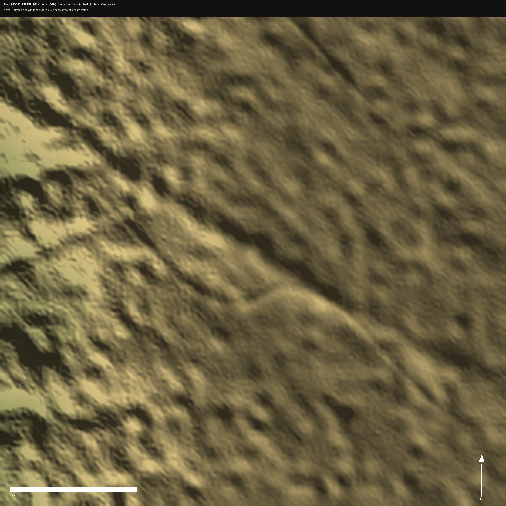

# BOB handoff — ASH

## Mission

You are BOB, lead implementation agent for **ASH**, a single-player Unity survival game. Take over the Unity project at `A:\ASH\`, establish a clean production foundation, and build a playable vertical slice.

- Repository: <https://github.com/LittleWormOnAHook/ASH>
- Unity: **6000.4.11f1**; URP: **17.4.0**.
- Useful installed packages: Input System 1.19.0, AI Navigation 2.0.13, Timeline, and UGUI.
- Current state: a fresh URP project. Do not assume gameplay scripts, scenes, prefabs, or production art exist.
- Target platform: desktop PC.

## Creative direction

ASH is a grounded, tense wilderness-survival game in a Colorado-like foothills landscape near the Spanish Peaks. The tone is lonely, harsh, and realistic—not fantasy.

- Open shortgrass prairie lies eastward.
- Rolling hills, gullies, and playable cover occupy the center.
- Broken foothills and modest ridge lines rise westward.
- Planning, observation, careful travel, shelter, and resource management should matter more than constant combat.

Build a polished **first-five-minutes vertical slice**, not an incomplete giant open world.

## Terrain package



Terrain source is in [`Assets/Terrain/`](../Assets/Terrain/):

- `ASH_heightmap_4km_R16LE_4097.raw` — 4 km × 4 km master heightmap.
- `ASH_heightmap_4km_preview.png` — terrain visual reference, embedded above.
- `ASH_heightmap_metadata.json` — exact machine-readable asset data.
- `Tiles/ASH_heightmap_2km_{NW,NE,SW,SE}_R16LE_2049.raw` — optional seam-matched 2 km tiles.
- [`ASH_heightmap_import.md`](ASH_heightmap_import.md) — full import and placement notes.

> **Procedural fallback, not real DEM data.** The terrain is a deterministic art-direction approximation; USGS 3DEP retrieval was unavailable during asset generation. Do not call it surveyed, scanned, or real elevation data.

Reference area only: west **-104.9227°**, east **-104.8775°**, south **37.3900°**, north **37.4260°**.

| Master import setting | Value |
|---|---:|
| Resolution | 4097 × 4097 |
| Depth | 16-bit |
| Byte order | Windows / little-endian |
| Flip vertically | Off |
| Terrain width / length | 4000 m / 4000 m |
| Terrain height | 1400 m |
| Optional Terrain Y offset | 2000 m |

Use the master terrain for the first vertical slice. Use the tiled layout only when implementing streaming or multiple Terrains.

## First playable loop

1. Spawn in a believable wilderness area.
2. Explore using clear visual landmarks.
3. Gather basic resources.
4. Monitor survival needs.
5. Craft or place a useful survival item.
6. Reach a visible short-term objective or safe location.

### Required first-pass systems

- **Player:** third-person controller using the Input System: move, look, sprint, jump, crouch, gravity, ground detection, and responsive camera.
- **Interaction:** raycast-based center-screen prompt; use small components/interfaces, not a monolithic manager.
- **Inventory:** compact stack or fixed inventory; wood, stone, and one consumable should be collectable.
- **Survival:** health, stamina, hunger, thirst; sprint drains stamina; UI states must be legible; tune hunger/thirst for testing.
- **Crafting:** at minimum craft a campfire or basic shelter item from gathered materials.
- **World:** day/night-ready outdoor lighting, fog/atmosphere, and readable night. Keep it weather/temperature-ready but do not build those systems yet.
- **Objective:** a discoverable goal such as a ridge overlook or abandoned campsite that does not require reading a separate document.

## Environment

Create intentional sparseness rather than filling the whole map:

- A primary spawn area with one strong landmark.
- Prairie ground variation and grass.
- Rock outcrops and low ridges.
- Sparse trees/deadwood and resource nodes.
- A dry creek, drainage, or gully that lends traversal purpose.
- Distant mountain/ridge silhouettes.
- Human-scale collision, traversal, and sightlines.

Use performant placeholders until a real art pass is available.

## Structure and engineering

```text
Assets/
  _ASH/
    Art/ Audio/ Materials/ Prefabs/ Scenes/ ScriptableObjects/
    Scripts/
      Core/ Player/ Interaction/ Inventory/ Survival/ World/ UI/
  Terrain/
```

- Prefer ScriptableObjects for items, recipes, and tunable values.
- Avoid hidden scene-object dependencies.
- Keep scripts focused and names descriptive.
- Keep Unity Console free of errors.
- Never edit/delete the supplied RAW sources.
- Keep `Library`, `Temp`, `Logs`, and IDE output out of Git.

## Deliverables

1. `Assets/_ASH/Scenes/ASH_Prototype.unity` (or equivalent clearly named prototype scene).
2. Player prefab/controller.
3. Interaction, resources, inventory, survival, and crafting foundations.
4. HUD and interaction prompt.
5. Imported/dressed terrain that supports this loop.
6. `Docs/PrototypeStatus.md`: launch steps, controls, implemented systems, limitations, and next three tasks.
7. Focused commits pushed to `main` unless a feature branch is requested.

## Explicitly defer

Combat, enemies, multiplayer, elaborate building, procedural world generation, vehicles, and advanced weather. First complete and validate exploration → gathering → needs → crafting → objective.

## Done means

Someone can press Play, traverse convincing terrain, gather materials, see needs respond, craft a survival object, and reach a visible destination—with no broken references or Console errors.
